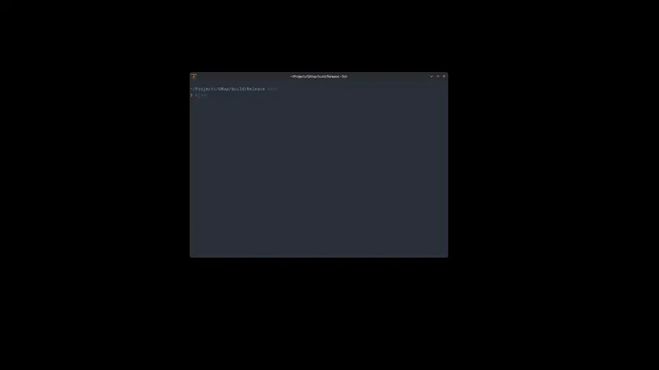

Intended to be used either directly for new games by reading from output JSON, or by feeding output JSON into custom converter program which would convert it to an already existing map file format for an existing game


# Usage

Run `GMap` and pipe a MapObject registry (JSON array of JSON objects) into its stdin (e.g. via `|`, `<`, OS API syscalls, ...) (ex.: `cat GMapObjectRegistry.json | GMap.exe`)

On exit: JSON of current map/scene is outputted to stdout (you can compose this with other programs/scripts (or just pipe to file: `> MAP_NAME.json`))

You can pass path to map/scene JSON file as first CLI arg to `GMap` to load it (ex.: `cat GMapObjectRegistry.json | GMap.exe MAP_NAME.json`)


# MapObject registry format

```json
[
        {
                "name": "Example_MapObject",
                "model": "PATH/TO/MODEL.obj",  // (optional texture has to be PNG with same base name in same dir as model ('PATH/TO/MODEL.png'))
                "data": [],  // zero or more of: "position", "rotation", "scale", "color", "user_model", "user_texture"
                "extra_data": {  // (bool, int, float, string) (OPTIONAL)
                        "example_1": true,
                        "example_2": 727,
                        "example_3": 6.7,
                        "example_4": "Hello, World!"
                }
        },
        {
                // ...^ repeat like above for 2nd MapObject...
        },
        // ...
]
```
- `"model"`: Path to (editor-only) model for MapObject. If a PNG texture with the same base name as the model in the same directory exists; it is used as the texture for the model. (NOT INCLUDED IN OUTPUT)
- `"data"`: Which data (with visual scene support) to include in inspector (where the user can modify it) and the output. Must be zero or more of: `"position"`, `"rotation"`, `"scale"`, `"color"`, `"user_model"`, `"user_texture"`. (`"user_model"` and `"user_texture"` allow the user to select a custom model and texture (respectively) for each instance of the MapObject during runtime)
- `"extra_data"` (optional): Additional data (without visual scene support) to include in inspector and output (value of each member must be one of: `bool`, `int`, `float`, `string`)


# Controls

- While right mouse button is held down:
	- Mouse = rotate camera
	- WASD, Space, CTRL = move camera
	- Scroll = change camera move speed
	- Click = select/deselect object
	- 0 = reset camera position to 0, 0, 0
- Del = delete selected object
- Alt+D = duplicate selected object
- Alt+H = hide/show UI


# Example

Input:
```json
[
        {
                "name": "Solid",
                "model": "MapObjects/Solid.obj",
                "data": ["position", "rotation", "scale", "user_texture"]
        },
        {
                "name": "Prop",
                "model": "MapObjects/Prop_placeholder.obj",
                "data": ["position", "rotation", "user_model"]
        }
]
```

Output:
```json
[
        {
                "name": "Solid",
                "data": {
                        "position": [
                                0.0,
                                0.0,
                                0.0
                        ],
                        "rotation": [
                                0.0,
                                0.0,
                                0.0,
                                1.0
                        ],
                        "scale": [
                                10.0,
                                1.0,
                                10.0
                        ],
                        "user_texture": "textures/Tiles.png"
                }
        },
        {
                "name": "Prop",
                "data": {
                        "position": [
                                0.0,
                                1.0,
                                0.0
                        ],
                        "rotation": [
                                0.0,
                                0.0,
                                0.0,
                                1.0
                        ],
                        "user_model": "props/Chair.obj"
                }
        }
]
```